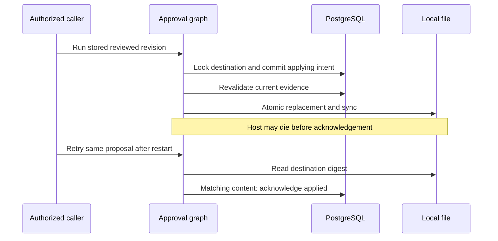

# Final code and design review

Reviewed October 24, 2026. The five confirmed defects below are fixed, and the
reviewed working tree passes **207 tests with one optional live-model test skipped**.
The six-workflow demonstration also passes twice against the same disposable
database/workspace without adding accepted records or replacing applied files.
No further blocking defect was identified within this local teaching contract.

## Scope and evidence

The base is `origin/main` and `HEAD` at
`81f2579b4b9366fb1e827d50cc6268e1c238d1e5`; there are no new commits above that base.
This review covers the uncommitted LangGraph modernization, six extension workflows,
SQL migrations, tests, and repository documentation. The existing hook work was
preserved and included in the full regression run and documentation boundary check.
This report describes the tested working tree, not a published commit.

Entire checkpoint context was unavailable: the CLI found no active session and
could not load the referenced checkpoint. Intent was checked against the current
conversation and [implementation plan](IMPLEMENTATION_PLAN.md), then against source,
API/database behavior, and independently specified regression outcomes. There is
no claim of an independently frozen revision review or production certification.

The agent baseline remains LangGraph 1.2.17, LangChain Core 1.7.0, OpenAI integration
1.7.2, Checkpoint 4.3.0, and PostgreSQL saver 3.2.0, with exact pins in
[requirements](demo_agents/requirements.txt). This review adds migration `010` and
application corrections; it does not change those dependency pins.

## Corrected findings

All cases below are exercised in
[test_final_review_regressions.py](tests/test_final_review_regressions.py).
Eight original regression cases failed before these fixes and passed afterward.
Two additional cases cover later file replacement and pre-upgrade research reports.

### `extensions/app.py` and `memory_engine/db.py`

**High — waiting approval requests could exhaust the connections needed by graph nodes.**
The `/run` request held a pool connection and graph advisory lock while nodes
acquired connections from the same pool. A burst of requests waiting on that graph
could consume all ten connections, preventing the active graph from finishing and
releasing its lock. PostgreSQL cannot resolve a cycle involving an application pool
wait as an ordinary database deadlock.

**Correction:** [application startup](demo_agents/extensions/app.py) gives approval
nodes a separate pool capped at five connections. The [pool factory](memory_engine/db.py)
accepts explicit sizes while retaining the original defaults for other callers.
Shutdown closes both pools. The regression queues twelve requests behind an
externally held graph lock, observes all ten API connections waiting, releases the
lock, and requires all requests to finish. This is a bounded contention test, not
a throughput benchmark.

### `extensions/approval.py`, `common.py`, and migration `010`

**High — a file effect could survive a crash while its proposal remained editable or cancellable.**
Previously the file replacement and database acknowledgement occurred inside one
database transaction. Process death after replacement rolled back the acknowledgement
while leaving the file changed and the proposal `approved`. Editing or cancellation
could then conceal the attempted effect. A later support-policy change could also
prevent acknowledgement of content already written.

**Correction:** [approval](demo_agents/extensions/approval.py) commits `applying`
and `effect_started_at` before file I/O. A [destination session lock](demo_agents/extensions/common.py)
spans intent, replacement, and acknowledgement. [Migration 010](memory_engine/migrations/010_approval_effect_intent.sql)
adds the state and timestamp constraint. Edits/cancellation reject started attempts;
the legacy path also detects approved content already present at the destination.
Retry acknowledges matching proposed content without replacing it or requiring a
new policy decision about that past observation. A fresh write still revalidates
evidence. Conflicting later content returns 409 and preserves `applying` for inspection.



The tests exit the actual host after replacement, restart it, and attempt an edit,
cancellation, a policy change, or a second approved write. An overwritten destination
cannot be silently replayed or cancelled. `applied_at` is acknowledgement time,
not an independently observed write timestamp. The [recovery table](EXTENSIONS.md#recovery-and-limits)
documents conflicts and stale unexecuted intent; there is no automatic rollback.

PostgreSQL session advisory locks persist across transaction commits until explicitly
released or the session ends, which is the required lifetime here.
[PostgreSQL advisory-lock semantics](https://www.postgresql.org/docs/16/explicit-locking.html#ADVISORY-LOCKS).

### `extensions/research.py`

**High — valid citations could hide omitted contrary evidence and produce trusted support.**
The old worker truncated candidates to sixteen before deduplication. Repeated support
statements could push a contrary statement out of that slice. A partial model response
could similarly omit contrary evidence: validating returned citations alone did not
establish extraction completeness.

**Correction:** [research extraction](demo_agents/extensions/research.py) validates
and deduplicates all unique labelled fixture statements, records completeness per
source/version/claim, and marks an incomplete one-sided result `insufficient`.
Observed support and contradiction remain `disputed`. Reports carry
`complete-labelled-evidence/2`; acceptance and trusted recall exclude older protocols.
The regressions cover sixteen duplicate supports followed by a contradiction,
an injected generator omitting that contradiction, and an already accepted report
without the new protocol. Current source snapshots and authorized human review are
still required. This checker establishes coverage of a small labelled grammar,
not general natural-language entailment.

### `extensions/support.py`

**High — expiry checks could accept a policy that expired during a lock wait.**
Using `now()` read the transaction's start time even after waiting for a source lock.
An approval could therefore use evidence that was already expired when validation ran.

**Correction:** [support retrieval](demo_agents/extensions/support.py) uses
`clock_timestamp()` after lock acquisition. The regression starts approval while
holding the source lock, lets the policy expire, then releases the lock and requires
409. PostgreSQL documents that `now()` uses transaction-start time while
`clock_timestamp()` reads actual current time.
[PostgreSQL current-time functions](https://www.postgresql.org/docs/16/functions-datetime.html#FUNCTIONS-DATETIME-CURRENT).

### `extensions/procedures.py`

**Medium — bounded but deeply nested artifact JSON escaped as a server error.**
An artifact within the request's character limit could exceed the JSON parser's
recursion depth. The independent checker did not catch `RecursionError`, so the
attempt failed with HTTP 500 rather than recording a failed verification.

**Correction:** the [artifact checker](demo_agents/extensions/procedures.py) treats
recursion errors as parse failures and persists diagnostic evidence with
`verified=false`. The regression submits an actual deeply nested artifact through
the API and checks the stored failure. The ordinary schema, value, row-budget, and
promotion-permission checks remain in place.

## Design assessment

The architecture fits the educational scope. Its central distinction is between
model-generated proposals, application-owned authority, and observed evidence.
Keeping these boundaries explicit is more useful here than introducing more agents.

| Decision | Assessment and practical limit |
|---|---|
| Custom `StateGraph` workflows | Appropriate for explicit retrieval, tool scope, leases, extraction, and approval boundaries. A standard `create_agent` loop is a future option when its lifecycle fits; it is not needed to make these graphs current. |
| Checkpoints separate from domain records | Checkpoints resume a thread; domain tables own user scope, evidence, revisions, promotion, and corrections. The approval API resolves the stored thread and decision; a resume payload has no authority. |
| Deterministic validation | Policy grammar, artifact checker, event projection, and query-plan validation remain application code. Models can propose outputs where useful, but cannot grant review/promotion or grade their own artifacts. |
| Bounded fan-out with a baseline | Research has at most eight source documents and three concurrent workers. Sequential and parallel output are compared on identical input; no live latency or quality advantage is asserted. |
| File-effect intent and reconciliation | A durable attempt precedes filesystem I/O; digest reconciliation handles the tested local destination. Conflicting attempts remain visible for inspection. Remote effects need their own contract. |
| Restricted analytics identities | Distinct tenant logins, `session_user` mapping, RLS, column grants, typed plans, and statement budgets provide separate checks. Direct-login tests exercise scope independently of API validation. |
| Domain-specific schemas | Support, incidents, procedures, and research have different evidence semantics and keep separate tables. They share stable authorization/locking helpers without a generic memory framework hiding the differences. |

The distinction between thread checkpoints and cross-thread memory is consistent
with the [LangGraph persistence model](https://docs.langchain.com/oss/python/langgraph/persistence).
The application remains responsible for access, evidence eligibility, deletion,
and effects beyond the checkpoint store.

## Verification

Commands were run from the repository root with separate Python 3.12 engine and
test environments. Docker supplied disposable PostgreSQL 16 with pgvector.

```bash
.venv-tests/bin/python tests/run_isolated.py --engine-python .venv-engine/bin/python tests/test_final_review_regressions.py
.venv-tests/bin/python tests/run_isolated.py --engine-python .venv-engine/bin/python
.venv-tests/bin/python tests/run_isolated.py --engine-python .venv-engine/bin/python --extensions-demo
.venv-tests/bin/python -m demo_agents.extensions.evaluate --mode scripted --output /tmp/pg-final-review-evaluation.json
uv pip check --python .venv-tests/bin/python
uv pip check --python .venv-engine/bin/python
uvx ruff check --select F demo_agents/extensions demo_agents/agents demo_agents/main.py memory_engine/db.py tests/extension_host.py tests/test_extension_*.py tests/test_final_review_regressions.py tests/test_langgraph_v1.py tests/run_isolated.py
uvx ruff format --check demo_agents/extensions memory_engine/db.py tests/extension_host.py tests/test_extension_*.py tests/test_final_review_regressions.py tests/run_isolated.py
git diff --check
```

| Check | Observed result |
|---|---|
| Targeted final-review regressions | 10 passed in 13.11s; eight initial cases were also observed failing before the fixes |
| Full disposable suite | 207 passed, 1 skipped in 79.19s; one existing `python_multipart` deprecation warning |
| Twice-run extension demo | Both runs passed with 3 proposals, 2 reviews, 2 attempts, 2 incident events, 2 research documents, 2 research reports, and 1 analytics run; file modification times unchanged |
| Scripted evaluations | Demo used authorized PostgreSQL procedure recall; standalone run used independently checked local training evidence; both passed |
| Dependency consistency | All 78 test-environment and 43 engine-environment installed packages compatible |
| Static checks | Undefined/unused-name checks passed across changed agent/extension code and relevant tests; 25 selected files passed formatting; diff whitespace clean |
| Documentation | All ten Markdown files parsed/rendered to HTML; relative links, anchors, and table columns valid; 30 shell examples and six SQL blocks parsed |
| Published API | All 22 operations across 21 extension paths expose response schemas; `applying` and `effect_started_at` appear in the approval contract |
| Resource cleanup | No disposable `memory-test-*` containers remained after the suite/demo; runners closed hosts and removed their temporary workspaces |

Documentation validation covers all ten repository Markdown files: relative links
and anchors, table column consistency, HTML generation, shell syntax, and
SQL parsing. OpenAPI response contracts were checked separately. These checks do
not execute every instructional command or render Mermaid in a browser.

The one skipped case is optional real-model extraction, gated by `LIVE_LLM_EVAL=1`
and provider credentials. The isolated runner clears live-model configuration.
No live provider, original real-model `make demo`, remote deployment, or sustained
load run was performed in this review. Tests exercise actual PostgreSQL operations
and graph-host restarts but use scripted generation and deterministic embeddings.

## Operating limits and next evidence

- Stop older graph hosts before applying migration `010`; preserve valued database
  and workspace data. Reconcile attempts through the authorized API and regenerate
  old-protocol research reports with new IDs. [Upgrade procedure](REMEDIATION.md#start-or-upgrade).
- An `applying` attempt with conflicting content or stale unexecuted evidence can
  need operator inspection and a separately reviewed new proposal. There is no
  general rollback, forced cancellation, or atomic database/filesystem transaction.
- Extension evidence, old checkpoints, and workspace files have no general retention
  service. Companion forgetting covers only companion records/checkpoints; hook
  excerpts have a separate project/branch/session deletion API. Use disposable
  synthetic data until a broader lifecycle is implemented.
- Source validation proves the bounded fixture semantics. It does not establish
  general entailment, prompt-injection resistance, representative model quality,
  or that a promoted procedure generalizes outside its checked task family.
- Migration/application connections remain privileged in this teaching stack.
  Production work needs separate runtime privileges, credential lifecycle, resource
  budgets, observability, retention, and measured concurrency/recovery targets.
- Future curriculum work should first measure the supplied live evaluation on a
  representative held-out set, then extend a single destination or task family
  with explicit failure cases. More agent hierarchy is not a prerequisite.

All nine existing Markdown guides were updated, and this report is the tenth.
No commit, push, deployment, or external message was performed. The reviewed changes
and the preserved earlier modernization/hook work remain in the working tree.
