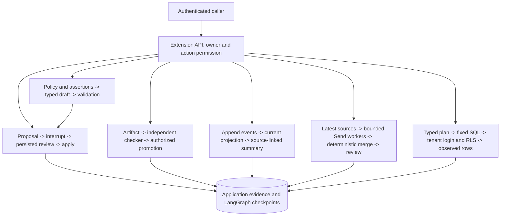

# Operating the six extension workflows

These are bounded teaching examples backed by real LangGraph execution and PostgreSQL. The [curriculum](USE_CASES.md) explains the learning goals; [fixture contracts](demo_agents/extensions/CONTRACTS.md) define expected outputs and denials. The [final code and design review](DESIGN_REVIEW.md) records corrections and verification limits. The original engine and twelve-scenario demo retain their separate lifecycle.

## Run the offline demonstration

Prerequisites: Docker, Python 3.12, the existing `.venv-engine`, and the test environment. From the repository root:

```bash
uv pip install --python .venv-tests/bin/python -r tests/requirements.txt
make extensions-demo PYTHON=.venv-tests/bin/python ENGINE_PYTHON=.venv-engine/bin/python
```

The isolated runner creates a uniquely named PostgreSQL container, applies the base schema and migrations, starts the engine with fake embeddings, provisions two restricted analytics logins, and launches a separate graph host. It runs all six workflows twice against the same database/workspace, checks unchanged record counts and file modification times, and evaluates held-out transformations using actual authorized procedure recall. It then closes the hosts and removes the container and temporary workspace. No provider credentials are needed or loaded by this command.

Expected outputs include `approval: applied`, corrected/cited support plus stale-evidence rejection, verified procedure promotion and failed-attempt denial, a late incident event before recovery, research disagreement retained with matching sequential/parallel output, and an Alice-only paid-order total of 40. The final evaluation is labelled `scripted`, with live quality unverified.

```bash
make test PYTHON=.venv-tests/bin/python ENGINE_PYTHON=.venv-engine/bin/python
make extensions-eval PYTHON=.venv-tests/bin/python
```

The second command saves a standalone scripted evaluation to `/tmp/pg-extension-evaluation.json`. It uses independently checked local training evidence. The full offline demo instead supplies procedures retrieved from PostgreSQL. Neither result establishes model improvement.

## Implementation map

| Workflow | Graph and API | Evidence and primary check |
|---|---|---|
| Approval | [approval.py](demo_agents/extensions/approval.py) | [approval tests](tests/test_extension_approval.py): review, edits, scope, duplicate/concurrent runs, actual host death and file reconciliation |
| Support | [support.py](demo_agents/extensions/support.py) | [support tests](tests/test_extension_support.py): source versions, expiry, correction, contradiction, invented/missing citations, stale approval |
| Procedures | [procedures.py](demo_agents/extensions/procedures.py) | [procedure tests](tests/test_extension_procedures.py): independent artifact check, promotion permission, compatibility and retirement |
| Incidents | [incidents.py](demo_agents/extensions/incidents.py) | [incident tests](tests/test_extension_incidents.py): occurrence/receipt order, source corrections/revocation, stale summaries, concurrent duplicates |
| Research | [research.py](demo_agents/extensions/research.py) | [research tests](tests/test_extension_research.py): bounded `Send`, sequential baseline, exact version/quote checks, disagreement, review freshness |
| Analytics | [analytics.py](demo_agents/extensions/analytics.py) | [analytics tests](tests/test_extension_analytics.py): plan denials, actual login/RLS isolation, forbidden columns/writes/role changes, database timeout |

The [final review regressions](tests/test_final_review_regressions.py) additionally exercise connection starvation, post-crash edits/cancellation and intervening writes, policy expiry during a lock wait, incomplete research extraction, legacy report exclusion, and deeply nested artifact input.



Approval is the only extension requiring a durable pause. Its database record owns the checkpoint thread ID. Each edit creates a new revision and thread. The other graphs are bounded, recomputable transformations whose input/output evidence lives in domain tables; adding checkpoints to them would not create additional authorization guarantees.

## Run a persistent local host

Use a disposable development database initialized from `postgres/init.sql`. Start the existing engine first so its migration runner applies `004`–`010`, or run the extension host once to apply them. Both hosts serialize migrations. Migration `009` creates a database reader group and therefore requires a database administrator/role-creating migration connection. Migration `010` adds the `applying` state and durable effect-start timestamp. Stop older extension hosts before upgrading an existing database; they do not enforce the new state transition. The supplied Compose database user is an administrator; this is a local-demo boundary, not a recommended production privilege layout.

Set `POSTGRES_HOST`, `POSTGRES_PORT`, `POSTGRES_DB`, `POSTGRES_USER`, and `POSTGRES_PASSWORD` for that database. Keep secrets in your environment/private files. Configure `MEMORY_AUTH_TOKENS` using the existing bearer-token format; every token must be at least 32 characters. A scoped writer grant looks like this (the key is your generated token, not this placeholder):

```json
{
  "your-generated-token-of-at-least-32-characters": {
    "subject": "writer-alice",
    "users": ["alice"],
    "permissions": ["extensions:read", "extensions:write", "extensions:submit", "extensions:run"]
  }
}
```

Give a separate reviewer credential `extensions:review` and, where needed, `extensions:promote`; it also needs base read/write access and the relevant `users` scope. A credential needs `submit` as well as `review` to submit an operator correction. The reviewer subject is read from credential configuration, never a request field. Admin credentials deliberately bypass these local teaching grants.

Analytics provisioning is an explicit administrative command. It creates tenant-specific logins, rotates their passwords, and writes a private configuration file. Restart an existing host after rotating those credentials. Only the demonstration flag adds synthetic orders.

```bash
.venv-tests/bin/python -m demo_agents.extensions.provision \
  --user alice --user bob --seed-fixtures --output /tmp/extension-analytics-logins.json
export EXTENSION_ANALYTICS_CONFIG=/tmp/extension-analytics-logins.json
export EXTENSION_WORKSPACE=/tmp/extension-workspace
.venv-tests/bin/python -m uvicorn demo_agents.extensions.app:app \
  --host 127.0.0.1 --port 8002
```

Provision after migrations and before the final host start. Without `EXTENSION_ANALYTICS_CONFIG`, the other five workflows work and analytics returns 503. Schema migrations and checkpoint pools use the configured application credentials; analytics uses separate restricted pools and validates the login-to-tenant mapping at startup. API requests use a ten-connection pool, approval nodes use a separate pool capped at five, and the saver owns its own connections. This prevents waiting API requests from consuming every connection needed to finish their graph. Account for all pools when sizing PostgreSQL; the contention regression establishes correctness for its bounded workload, not production capacity.

The OpenAPI schema is at `http://127.0.0.1:8002/docs`. The API never accepts raw checkpoint config, an owner override, SQL, a reviewer identity, or a promotion score.

| Route suffix under `/extensions` | Contract |
|---|---|
| `POST /proposals` | UUID, user, basename target, base SHA-256 and proposed UTF-8 content |
| `GET /proposals/{id}` | Authorized current revision and generated diff |
| `POST /proposals/{id}/run` | Empty object; start/pause or resume persisted authorized review |
| `POST /proposals/{id}/review` | Exact revision, digest and approved/rejected decision |
| `POST /proposals/{id}/edit` or `/cancel` | Edit requires current revision and content; cancel takes an empty object; neither can change a proposal whose effect has started |
| `POST /support/policies`, `/support/assertions`, `/support/drafts` | Versioned refund evidence, append-only corrections, bounded claim/citation draft |
| `POST /procedures/attempts`, `/{id}/promote`, `/{id}/retire` | Artifact and version evidence; promotion and retirement require separate permission |
| `GET /procedures?user_id=alice` | Currently promoted, verified and compatible procedures only |
| `POST /incidents/events` | Append-only source revisions with explicit correction or revocation links |
| `GET /incidents/{id}/timeline`, `GET/POST .../summary` | Current projection, stored summary freshness, or recomputation |
| `POST /research/documents`, `/research/reports`, `/research/reports/{id}/review` | Local document revisions, parallel/sequential reports, exact-report review |
| `GET /research/{id}/assertions?user_id=alice` | Supported, reviewed assertions with current source snapshots and the current extraction protocol |
| `POST /analytics/query` | Run UUID, authorized user and strict plan; stores executed plan and observed result |

## Recovery and limits

The host owns its workspace. Files are in a hashed user directory and targets are basenames; symlinks are rejected. Application writers lock a destination, compare its digest, commit `status=applying` with `effect_started_at`, then atomically replace and sync the file before acknowledging `applied`. A session advisory lock spans both database commits and is released when the connection dies. Once intent is committed, edits and cancellation return 409 so an ambiguous file effect cannot disappear from the proposal history. `effect_started_at` records intent and `applied_at` records acknowledgement; neither is an independently measured filesystem write time.

After a restart, send an empty object to the same authorized `/proposals/{id}/run` endpoint. Do not choose a checkpoint thread or reset the database status manually:

| Observed destination | Recovery behavior |
|---|---|
| Matches the proposed digest | Acknowledge the observed content without replacing it, even if support policy changed after the effect |
| Matches the base digest | Revalidate evidence against the current clock, then apply the reviewed revision if it remains eligible |
| Matches neither digest | Return 409 and preserve the attempted effect; inspect the later write and prepare a separately reviewed proposal if needed |
| Base matches but evidence became stale after intent | Return 409 and retain `applying`; inspect the attempt and generate a fresh draft/proposal from current evidence |

An `applying` record can require operator reconciliation; there is no force-cancel or rollback API for an attempted effect. The regressions kill a host during review, exit after replacement, and try later edits, cancellation, a policy change, and a second reviewed write. Content equality is a reconciliation observation, not proof of a universal exactly-once action. Arbitrary concurrent operating-system writers and remote destinations need additional contracts.

Application grants separate proposal submission from review and procedure promotion. Source/current-snapshot locks serialize evidence updates with acceptance. Support uses `clock_timestamp()` after lock acquisition so a policy that expired while waiting cannot pass with the transaction's older start time. Domain tables retain prior revisions and correction history. There is no general retention/deletion policy for extension evidence or old checkpoints yet; use synthetic data and disposable databases for the workshop. Companion forgetting deletes only companion records and companion checkpoint threads. It does not delete extension evidence, extension checkpoints, workspace files, or project/branch hook excerpts; [hook removal](AGENT_HOOKS.md#verify-and-remove-memory) is a separate operation.

Support checks one refund rule and a reported purchase age. Research validates two claim IDs and exact labelled statements in at most eight documents of 8,000 characters each. Reports record per-source/per-claim extraction completeness under `complete-labelled-evidence/2`. Missing evidence makes a one-sided conclusion `insufficient`; observed support and contradiction remain `disputed`. Duplicate statements are deduplicated without silently truncating contrary evidence. Reports from an older extraction protocol remain diagnostic history and cannot enter trusted recall; regenerate with a new report ID and review again after upgrading.

Citation membership, these bounded semantics, and general entailment are different properties. The fixtures include malicious-looking instructions, but successful fixture rejection is not a general prompt-injection defense. A verified transformation proves its artifact passed the checker; human promotion does not prove the procedure generalizes to all inputs. Malformed or excessively nested artifact JSON is stored as a failed attempt with diagnostics instead of escaping as an internal server error.

Analytics exposes two fixed views and one approved customer-region join. PostgreSQL RLS uses `session_user` with a private login mapping; setting an arbitrary tenant GUC cannot impersonate another login. Column grants hide internal notes. The API caps rows at 50 and applies a 250 ms statement timeout in a read-only transaction. Direct login tests establish database isolation and mutation denial; the service's resource budget is not a claim that an attacker possessing database credentials cannot change session settings.

## Provider evaluation

Provider calls occur only in the explicit evaluation command. Set `LLM_API_KEY`, `LLM_MODEL_NAME`, and optionally `LLM_BASE_URL` for a compatible chat provider with JSON-schema structured output. This command makes a small bounded set of model calls and may incur provider charges:

```bash
.venv-tests/bin/python -m demo_agents.extensions.evaluate \
  --mode live --output /tmp/extension-live-evaluation.json
```

To compare with procedures actually recalled from the service, set `MEMORY_API_TOKEN` to a scoped reader and add `--service-url http://127.0.0.1:8002 --user alice`. Otherwise the harness uses an independently checked local training fixture and labels that origin. The fixed held-out tasks are identical with and without memory; model and 512-output-token budgets remain fixed. Research compares the same two documents sequentially and in parallel. Support checks the same independently specified claim/citations.

Results record the configured model, per-call observed latency and token usage when supplied. They do not infer dollar cost or a statistically reliable improvement from two tasks. No live-provider result is included in the deterministic suite. Provider schema failures or request failures make the evaluation fail visibly; do not relabel scripted output as a live result.
