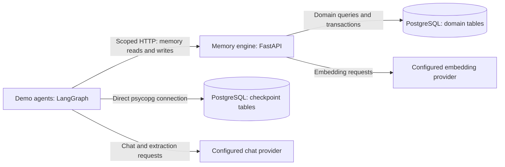

# pg-agent-memory-demo: A Reference Implementation of Agent Memory Patterns

A Docker Compose stack demonstrating six agent memory and coordination patterns using **PostgreSQL** (pgvector + pg_trgm), **LangGraph**, and a configured **OpenAI-compatible chat and embedding endpoint**.

---

## What you will learn

Model requests only use the context supplied to them; an application must decide what to retain, retrieve, update, and delete between requests. A larger context window does not remove those decisions. Retrieving previous experience changes the input to a model; it does not train its weights or prove that a stored claim is true.

This repository teaches six concrete storage and coordination patterns in PostgreSQL. LangGraph provides the control flow and thread checkpoints; the memory engine provides domain records across threads. The examples are inspectable teaching implementations, with deterministic regression checks and separate live-provider evaluation.

Start with the [guide and workshop path](GUIDE.md#workshop-path), use the [runbook](RUNBOOK.md) to operate the stack, and see [additional use cases](USE_CASES.md) for six implemented extension workflows with acceptance evidence. The checked agent baseline is LangGraph 1.2.17 with LangChain Core 1.7.0 and OpenAI integration 1.7.2; exact dependencies live in [demo requirements](demo_agents/requirements.txt).

The [final code and design review](DESIGN_REVIEW.md) records the corrected concurrency, crash-recovery, evidence-completeness, expiry, and artifact-validation defects, with the commands and limits of the local verification.

---

## Architecture



Domain and checkpoint tables share the PostgreSQL service. Checkpoints preserve a thread's execution state; they do not replace domain schemas or their authorization rules. Direct database access by the demo runner is trusted application access, not a model tool.

| Service | Role | Host Port |
|---------|------|-----------|
| `postgres` | PostgreSQL 16 with `vector`, `pg_trgm`, `uuid-ossp` + LangGraph checkpoint tables | `5434` |
| `memory-engine` | FastAPI REST API for ingestion, retrieval, and state transitions | `8001` |
| `demo-agents` | LangGraph agent runner with tool calling, write-back, and checkpointer | — |

---

## Six Memory Patterns

Each pattern addresses a distinct agent archetype with different memory requirements. The following table maps each pattern to its storage primitives, retrieval algorithm, and the application behavior it illustrates:

| # | Archetype | Memory Type | PostgreSQL Primitive | Retrieval Algorithm | Application Behavior |
|---|-----------|------------|---------------------|-------------------|-------------------|
| 1 | **Developer Assistant** | Symbolic Code Memory | halfvec HNSW + pg_trgm GIN | RRF (Cosine ANN + trigram) | Semantic recall + pattern matching |
| 2 | **Autonomous Task Agent** | Episodic Trajectory Memory | halfvec HNSW + REAL filter | Similarity search with success gate | Reuse of recorded task examples |
| 3 | **Enterprise Knowledge Agent** | Versioned Policy Memory | halfvec HNSW + tsvector GIN | Reciprocal Rank Fusion (RRF) | Role-gated knowledge retrieval |
| 4 | **Adaptive Tutor** | Skill Tree Memory | CTE + decay function | Forgetting-curve gap analysis | Heuristic decay and prerequisite readiness |
| 5 | **Multi-Agent Swarm** | Blackboard Memory | FOR UPDATE SKIP LOCKED | Row-locked task claiming with leases | Concurrent task coordination |
| 6 | **AI Companion** | Relational Identity Memory | Graph + TTL + chunk HNSW | Multi-domain context merge | User, persona, and shared assertions |

For detailed analysis including compare/contrast with alternative approaches, production considerations, and LangGraph integration patterns, see **[GUIDE.md](GUIDE.md)**.

---

## Quick Start

```bash
cp .env.example .env
# Edit .env with your API credentials
python tools/configure_auth.py
make build up
make demo   # seeds first and resets the demo companion user
```

Once running:

- **API docs:** http://localhost:8001/docs
- **Health check:** `curl http://localhost:8001/health`
- **Demo output:** streamed by `make demo` from its temporary one-off container

Seeding uses a separate admin credential. The agent runner receives a scoped token. Shell execution is disabled in the Compose runner; local operators can enable the disposable Docker sandbox. See [operating contracts and migration notes](REMEDIATION.md).

---

## Configuration

### External agent hooks

Claude Code, Codex CLI, and Hermes can recall project/branch session context and
save completed turns through the shared memory engine. The adapters use native
command hooks, scoped credentials, and PostgreSQL text search; they require no
extra model calls. See [agent hook setup and limitations](AGENT_HOOKS.md) for
configuration snippets, generic adapter support, and verification steps.

### Model configuration

The chat model must support tool calling; the embedding endpoint must produce vectors with the configured schema dimension. OpenAI-compatible endpoints differ in supported parameters and content formats, so test the chosen model/provider pair. Model names below are configuration examples, not a recommendation of the newest model.

Model settings are in `.env`; `tools/configure_auth.py` creates private API credentials in `.env.auth`:

```ini
LLM_BASE_URL=https://api.openai.com/v1      # Any OpenAI-compatible endpoint
LLM_API_KEY=sk-...                           # Your API key
LLM_MODEL_NAME=gpt-4o-mini                   # Chat model (or ollama/mistral, etc.)
EMBEDDING_BASE_URL=https://api.openai.com/v1 # May differ from LLM endpoint
EMBEDDING_API_KEY=sk-...                     # Embedding API key
EMBEDDING_MODEL_NAME=text-embedding-3-small  # Must match halfvec dim in init.sql
EMBEDDING_DIM=1536                           # Documentation only — hardcoded in SQL
```

For a chat model served locally, override the chat settings, for example:

```ini
LLM_BASE_URL=http://host.docker.internal:11434/v1
LLM_MODEL_NAME=llama3.1
```

Keep the separately configured embedding endpoint unless a matching embedding model is served locally. Changing `EMBEDDING_DIM` alone does not migrate the schema or make an incompatible model work.

Optional — LangSmith access for the trace tooling (`tools/`):

```ini
LANGSMITH_API_KEY=ls-...       # smith.langchain.com API key
LANGSMITH_PROJECT=eidolon-prod # Project/session to pull traces from
```

---

## Testing and Evaluation

The integration and regression tests validate database behavior, scope isolation, graph control flow, concurrency, and the companion memory pipeline. Deterministic retrieval checks validate fixture behavior; they do not establish real-model retrieval or answer quality:

Install the separate engine and test environments described in [REMEDIATION.md](REMEDIATION.md), then run:

```bash
make test PYTHON=.venv-tests/bin/python ENGINE_PYTHON=.venv-engine/bin/python
```

The runner creates and removes disposable services. Deterministic embeddings test application logic; real model quality is evaluated separately with explicit provider credentials.

| Coverage | Where to look | What it establishes |
|----------|---------------|---------------------|
| Pattern storage and retrieval | `tests/test_developer.py` through `tests/test_companion.py` | Expected API results, filtering, ranking on fixtures, and lifecycle transitions |
| Runtime and agent behavior | `tests/test_agent_regressions.py`, `tests/test_langgraph_v1.py` | Actual graph/tool loops, scoped dispatch, message blocks, limits, forgetting, and PostgreSQL fan-out resume |
| Review and pipeline regressions | `tests/test_review_regressions.py`, `tests/test_pipeline_regressions.py`, `tests/test_followup_regressions.py`, `tests/test_main_sync_regressions.py` | Previously fixed failures in migrations, provenance, replay, repeatability, and authorization |
| Six extensions and final review | `tests/test_extension_*.py`, `tests/test_final_review_regressions.py` | Actual approval restart/reconciliation, bounded contention, evidence freshness/completeness, checked promotion, incident history, and tenant database isolation |
| External agent hooks | `tests/test_hooks.py` | Adapter protocol fixtures and scoped PostgreSQL recall/capture; installed host compatibility requires a separate smoke test |
| Synthetic and concurrency scenarios | `tests/test_synthetic.py`, `tests/test_agent_evals.py` | Controlled labels, cross-pattern isolation, and bounded concurrent claims |

See the [evaluation layers](GUIDE.md#evaluation-layers) for the evidence still needed beyond deterministic checks. Test counts are intentionally omitted here so this table remains useful as the suite grows.

For testing the companion memory with real or synthetic data, see the **`tools/` pipeline** below.

---

## Project Structure

```
├── docker-compose.yml          # 3 main services + one-off seed profile
├── .env.example                # Configuration template
├── Makefile                    # up, down, test, test-eval, ci, clean
├── GUIDE.md                    # Educational deep-dive & taxonomy
├── RUNBOOK.md                  # Operations & troubleshooting
├── EXTENSIONS.md               # Six workflows, permissions, recovery, and evaluation
├── DESIGN_REVIEW.md            # Final findings, design decisions, verification boundary
├── postgres/
│   └── init.sql                # Domain tables and indexes; saver creates checkpoint tables
├── memory_engine/
│   ├── Dockerfile
│   ├── main.py                 # FastAPI application
│   ├── db.py                   # asyncpg connection pool
│   ├── migrations/             # Versioned domain, hook, and extension upgrades
│   ├── embedding.py            # Shared OpenAI embedding client
│   └── routers/
│       ├── developer.py        # Symbol CRUD + hybrid search
│       ├── task_agent.py        # Trajectory store + similarity search
│       ├── enterprise.py       # RRF + RBAC document search
│       ├── tutor.py            # Skill tree + decayed proficiency query
│       ├── swarm.py            # Blackboard task lifecycle + SKIP LOCKED
│       └── companion.py        # Graph facts + self-model + provenance + valence
├── demo_agents/
│   ├── Dockerfile
│   ├── main.py                 # Seeds data, runs 12 demos (6 patterns + multi-turn + supervisor fan-out + companion lifecycle)
│   ├── extensions/             # Separate API host, bounded graphs, fixtures, and evaluation
│   └── agents/
│       ├── __init__.py
│       ├── checkpointer.py     # Deletion-aware AsyncPostgresSaver + pool lifecycle
│       ├── runtime.py          # Immutable run scope, prompt budget, scoped dispatch
│       ├── tools.py            # Domain tools + sandboxed execution tools
│       ├── developer_agent.py  # 3-node graph: search → agent → tools
│       ├── task_agent.py       # 3-node graph: recall → agent → tools
│       ├── enterprise_agent.py # 3-node graph: search → agent → tools
│       ├── tutor_agent.py      # 3-node graph: assess → agent → tools
│       ├── swarm_agent.py      # supervisor + Send API fan-out → workers (assigned or SKIP LOCKED pull) → aggregate
│       └── companion_agent.py  # retrieve → agent → tools + 3-scope fact extraction node
├── tools/
│   ├── pull_langsmith_traces.py  # Pull top-level LangSmith traces for a project
│   ├── pull_conversations.py     # Paginated pull of conversation traces (resumable)
│   ├── parse_traces.py           # Parse LangGraph / RunnableSequence / MasterGraph traces into turns
│   ├── replay_traces.py          # Replay parsed conversations through companion extraction → engine
│   ├── eval_recall.py            # Query /companion/context + probe queries for recall
│   ├── benchmark_extraction.py   # Compare extractor output against supplied labels
│   ├── generate_synthetic.py     # Generate synthetic conversations + controlled labels
│   └── cleanup_replay.py         # Forget replay/test users from the memory engine
└── tests/
    ├── conftest.py             # Shared fixtures + HTTP helpers
    ├── pytest.ini              # asyncio mode configuration
    └── test_*.py               # The integration and regression tests
```

---

## Companion Memory Design

The Companion pattern (Pattern 6) is the most feature-rich: it models **three subjects** in one graph — the user, the AI companion itself, and their shared relationship — so the application can distinguish user assertions, persona assertions, and shared interaction records. These are stored claims, not evidence that the model has personal experiences.

### Three-Subject Memory (`subject` column)

Every graph node and edge carries a `subject`: `user`, `self`, or `shared`.

| Subject | What it stores | Example |
|---------|---------------|---------|
| `user` | Durable facts the user revealed | `user LIVES_IN Seattle` |
| `self` | Persona assertions extracted from assistant outputs | `Vesper VALUES honesty` |
| `shared` | Assertions about shared interactions | `Vesper TRUSTS user`, `we SHARE_RITUAL morning coffee` |

`/companion/context` returns all three groups (`graph_facts`, `self_facts`, `shared_facts`), each relevance-ranked. The agent's system prompt is built **dynamically** from the self-model + shared + user facts each turn, so responses depend on memory state rather than a static personality script:

```
About YOU (your self-model, backstory and how you've grown): ...
About your RELATIONSHIP (shared facts, growing together): ...
Things you and the user have in common: pizza, hiking
```

### Backstory Seeding

`POST /companion/backstory` pre-populates the self-model per user (companion name, traits, history) plus initial shared facts. It is idempotent — re-seeding upserts rather than duplicating. The demo seeds Iris's backstory at startup.

### Common-Interest Detection

The retrieve node cross-references `user_facts` against `self_facts` on affinity predicates (`LOVES`, `ENJOYS`, `PLAYS`, `INTERESTED_IN`, ...) with normalized entity matching, and surfaces shared interests in the prompt — so the companion can naturally say *"hey, we both like pizza!"*.

### Emotional Scoring (valence + intensity)

Edges carry extractor-supplied `valence` (−1.0…+1.0) and `intensity` (0.0…1.0), clamped server-side. These annotations can inform response tone, but they are not calibrated emotion measurements. A pet's death requires ending a current ownership assertion or recording an appropriate historical event; negative valence alone does not change whether a relationship is current.

### Fact Provenance

Edges link to the episode they were inferred from via `source_episode_id`. `GET /companion/facts/provenance?user_id=...&name=...` traces any fact back to its exact source conversation, answering *"where did we learn that?"*. Full-text/semantic search finds *conversations*; provenance finds *which fact came from which message*.

### Entity & Relation Normalization

The engine canonicalizes entities (accent/case/punctuation-insensitive keys + alias map: `me`/`I` → `user`) and relation predicates (the extractor emits UPPER_SNAKE; the engine stores normalized lowercase snake_case). Normalized identities allow matching records to reuse existing nodes and active edges. Known aliases and predicate synonyms are handled; arbitrary paraphrases, identity ambiguity, and duplicate extraction still require evaluation.

---

## Memory Testing Pipeline (`tools/`)

The `tools/` directory provides a full pipeline for testing the companion memory using **exported LangSmith traces** or **synthetic data with controlled labels**:

| Tool | Purpose |
|------|---------|
| `pull_langsmith_traces.py` | Pull top-level LangSmith traces for a project |
| `pull_conversations.py` | Paginated, resumable pull of conversation traces |
| `parse_traces.py` | Parse LangGraph / RunnableSequence / MasterGraph traces into `(user, assistant)` turns |
| `replay_traces.py` | Replay parsed conversations through the companion extraction → memory engine |
| `eval_recall.py` | Query `/companion/context` + probe queries to measure recall |
| `benchmark_extraction.py` | Score extracted facts against supplied labels (precision/recall/F1) |
| `generate_synthetic.py` | Generate synthetic conversations with controlled labels (user/self/shared) |
| `cleanup_replay.py` | Forget replay/test users from the engine |

Configure `.env` with the permitted trace project and provider settings. These commands export and benchmark; they do not replay records into the engine. For replay and user-scoped cleanup, see the [runbook](RUNBOOK.md#companion-memory-tooling-tools).

**Real-trace workflow:**

```bash
.venv-tests/bin/python tools/pull_conversations.py --out /tmp/pg-memory-traces
.venv-tests/bin/python tools/benchmark_extraction.py --traces-dir /tmp/pg-memory-traces --sample 30
```

**Synthetic generation is offline; extraction benchmarking below calls the configured model:**

```bash
.venv-tests/bin/python tools/generate_synthetic.py --count 50 --out /tmp/pg-memory-synthetic
.venv-tests/bin/python tools/benchmark_extraction.py --traces-dir /tmp/pg-memory-synthetic --all
```

Synthetic generation is offline. The extraction benchmark calls the configured model; synthetic generation does not make that step offline. Trace-derived labels may be another model's outputs, so agreement with them is not independently verified truth. Review representative labels and keep evaluation cases separate from prompt tuning.

---

## Capabilities

This project implements three key agent capabilities on top of the memory engine:

### Tool Calling + Write-Back
Five agents use `ScopedToolNode` around LangGraph's `ToolNode`. Swarm workers use an application-controlled tool loop so each call can be checked against the active lease. All six use tool-bound `ChatOpenAI` models.

Memory tools query or update domain records. Execution tools are available only to the Developer, Task, and Swarm agents as appropriate. File access stays inside the workspace, HTTP requires an HTTPS host allowlist, and shell execution is disabled in the Compose demo. Tool availability is separate from authorization and verified completion.

The model selects proposed tool calls; application code binds trusted scope and enforces dispatch rules. A final model response is not proof that an external action succeeded.

### Bidirectional Memory
Agents both read from and write to the memory engine. For example:

- **Task Agent**: recalls past trajectories, executes a task, then stores the new trajectory with a success score
- **Swarm Agent**: claims a task from the blackboard, processes it, and marks it complete
- **Companion Agent**: retrieves user context, responds, then extracts and stores **user, self, and shared facts** with emotional valence and provenance

### Checkpointer (State Persistence)
The CLI uses the deletion-aware `AsyncPostgresSaver` and scoped thread IDs. Graph builders also accept no saver for focused tests. A checkpoint records graph state, while long-term records are written through the memory engine.

Multi-turn invocations reuse a thread within one run. Checkpointed runs default to synchronous durability, with 32 graph supersteps and five concurrent graph tasks. Application-owned pools close on CLI exit. PostgreSQL fan-out resume is tested at the native graph layer; the public `ScopedGraph.ainvoke` wrapper currently accepts new-turn dictionaries, not `Command` or `None` resume requests.

---

## Six additional workflows

The separate [extension service](EXTENSIONS.md) adds approval/resume, evidence-backed support, verified procedure promotion, incident timelines, a research evidence notebook, and restricted analytics. Every module runs an actual LangGraph workflow against PostgreSQL. Approval owns a durable checkpoint; the other workflows persist domain evidence and recompute bounded graphs.

Approval commits an `applying` record before file I/O so retries cannot erase an attempted effect through editing or cancellation. Research checks extraction completeness as well as exact citations; omitted evidence cannot silently become a supported assertion. [Recovery and upgrade instructions](EXTENSIONS.md#recovery-and-limits) explain unresolved effects and older reports.

Run all six twice in disposable local infrastructure, without provider credentials:

```bash
uv pip install --python .venv-tests/bin/python -r tests/requirements.txt
make extensions-demo PYTHON=.venv-tests/bin/python ENGINE_PYTHON=.venv-engine/bin/python
```

The command creates and removes a PostgreSQL container and temporary graph workspace. It checks that the second run does not duplicate accepted records or rewrite local effects, and runs a scripted comparison using actual authorized procedure recall. Docker must be available. The original `make demo` remains the twelve-scenario, configured-provider path.

See [operating commands and permissions](EXTENSIONS.md), [fixture contracts](demo_agents/extensions/CONTRACTS.md), and [implementation evidence](IMPLEMENTATION_PLAN.md). Scripted support/research use deliberately small claim vocabularies; these checks establish bounded semantics, not general natural-language entailment or production readiness.

## Limitations and Roadmap

| Area | Implemented | Still unproven or proposed |
|------|-------------|---------------------------|
| Memory | Domain retrieval/write-back, provenance, conflict closure, TTL filtering, forgetting | Accuracy of extracted claims, user correction UX, broad retention policy |
| Context | Ranked retrieval, character-bounded complete turns, refreshed system message | Token-aware compaction, persistent history retention limits, prompt-injection resistance |
| Control flow | Tool cycles, enterprise abstention, parallel workers, leases, separate approval/resume service | Handoffs and compiled worker subgraphs |
| Recovery | Checkpoints, native fan-out resume, approval-host death/restart and local-file reconciliation | Arbitrary remote effects, historical 0.6 checkpoint resume, crash recovery across every original pattern |
| Evaluation | Deterministic integration tests and model-dependent evaluation tools | Representative provider benchmarks, answer-quality baselines, operational load targets |

Companion forgetting removes that user's companion records and companion checkpoint threads and disables further companion recording. Extension evidence/checkpoints, workspace files, project/branch hook excerpts, exports, and backups have separate lifecycles. The extension host currently uses disposable data; a general retention/deletion service remains future work.

Graph depth and agent count are design choices, not maturity measures. Add a step or agent only when it improves a defined outcome and can be tested. The [extension curriculum](USE_CASES.md) connects each implemented workflow to its evidence and limitations.

---

## References

- **pgvector**: https://github.com/pgvector/pgvector
- **LangGraph workflows and agents**: https://docs.langchain.com/oss/python/langgraph/workflows-agents
- **Context engineering**: https://docs.langchain.com/oss/python/langchain/context-engineering
- **Modern agent API and migration**: https://docs.langchain.com/oss/python/migrate/langgraph-v1
- **HNSW Index**: Malkov & Yashunin (2018). "Efficient and robust approximate nearest neighbor search using Hierarchical Navigable Small World graphs." *IEEE TPAMI.*
- **Reciprocal Rank Fusion**: Cormack et al. (2009). "Reciprocal Rank Fusion outperforms Condorcet and individual rank learning methods." *SIGIR.*
- **Ebbinghaus Forgetting Curve**: Ebbinghaus, H. (1885). *Über das Gedächtnis.*
- **SKIP LOCKED**: PostgreSQL 9.5+ documentation. "SELECT … FOR UPDATE SKIP LOCKED."
