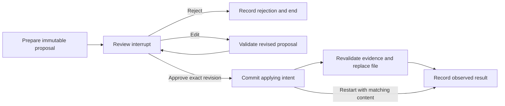

# Additional Use Cases and Teaching Curriculum

Implementation order, acceptance gates, and progress are tracked in [IMPLEMENTATION_PLAN.md](IMPLEMENTATION_PLAN.md). The [final code and design review](DESIGN_REVIEW.md) records the defects found, fixes, and remaining operating boundaries.

These six modules are now implemented under [demo_agents/extensions](demo_agents/extensions). They have a separate API host, PostgreSQL migrations, deterministic fixtures, and boundary tests. The original Developer, Task, Enterprise, Tutor, Swarm, and Companion examples remain the original teaching path. Run the new curriculum with the [offline extension command](EXTENSIONS.md#run-the-offline-demonstration). Existing [external agent hooks](AGENT_HOOKS.md) already provide project/branch session recall and completed-turn capture; that integration is a starting point, not evidence of automatic memory consolidation or verified learning.

The priorities below are editorial recommendations for this repository. They reflect new learning value, reuse of existing components, and the ability to verify a small implementation. They are not claims of customer demand or comparative framework performance.

## Workshop sequence

| Priority | Module | New capability it teaches | Building blocks and related patterns | First acceptance result |
|----------|--------|--------------------------|-------|-------------------------|
| P0 | [Approval and resume](#1-approval-and-resume) | Durable interruption, authorized review, replay-safe effects | Checkpointer, scoped runtime, workspace files | Reject writes nothing; approve after restart applies once |
| P0 | [Evidence-backed support](#2-evidence-backed-support) | Source/version attribution, corrections, and abstention | Approval service; enterprise versioning and companion provenance concepts | A changed policy invalidates a stale answer; unsupported claims abstain |
| P1 | [Verified procedural memory](#3-verified-procedural-memory) | Separate reported outcomes from independently verified reusable procedures | Trajectory concept; independent CSV/JSON checker | A failed attempt cannot enter the trusted recall set |
| P1 | [Incident timeline assistant](#4-incident-timeline-assistant) | Event time versus recording time, late evidence, and evidence-preserving summaries | Episode/provenance concepts; append-only incident tables | A late event changes the timeline without erasing its arrival history |
| P2 | [Research evidence notebook](#5-research-evidence-notebook) | Claim/evidence relationships, contradiction, scoped fan-out | Versioning/provenance concepts; `Send` | Contradictory sources remain visible and cited by source version |
| P2 | [Read-only analytics assistant](#6-read-only-analytics-assistant) | Typed query plans, database-enforced scope, resource limits | PostgreSQL, role checks, structured tool calls | Invalid plans fail validation; an expensive allowed read hits the database timeout |

Work through the modules in this order. Support reuses the approval service; each later module adds a distinct invariant. Related patterns supply teaching concepts; extension evidence lives in separate `ext_` tables rather than reading original enterprise/companion records or hook summaries. The bounded fixtures are deliberately inspectable. Source and tests for every stage are listed in [EXTENSIONS.md](EXTENSIONS.md#implementation-map).

## 1. Approval and resume

**Scenario:** a developer assistant proposes a change to a workspace file. A reviewer sees the exact diff, can reject it, and can approve it after the application restarts. A submitter can edit it before the effect starts; the revision then needs a new review. This implementation updates a local fixture file.

**Teaching point:** the original agents persist graph state; the extension adds a public human-review lifecycle. This module teaches that saving a checkpoint and authorizing a resumed action are different responsibilities. LangGraph's [interrupt documentation](https://docs.langchain.com/oss/python/langgraph/interrupts) provides the pause/resume primitives; application code must own authorization and effect semantics.

**Implemented scope:** store `proposal_id`, owner scope, target path, base-content digest, proposed content/diff, proposal digest, review status, reviewer identity, effect key, and `effect_started_at`. The graph uses `interrupt()` for review and `Command(resume=True)` to continue after checking the separately persisted review. The resume value itself grants no authority. A separate effect node commits `applying` intent before crossing the filesystem boundary. Edits and cancellation cannot erase a started attempt. Stale revisions are rejected at review, and destination digests are checked before application. The model cannot select its approver or supply the authorization decision.

The current `ScopedGraph.ainvoke` accepts a new-turn dictionary and derives scope from it. It does not accept `None` or a `Command` for resume. The dedicated extension service resolves the checkpoint by the authorized proposal owner, loads its server-created thread, and validates the persisted decision before native resume. Do not expose raw graph invocation as the review API.

**Acceptance fixtures:** reject; edit then approve; approve after process restart; forged owner; stale base file; duplicate approval; a pool-saturating run burst; crash after file update but before recording the result; edit/cancel after that crash; and a later approved write. The observable requirements are zero effects on rejection, the approved revision only, and no repeated replacement when retry observes the proposed content. A unique database row alone does not prove an external effect happened once. Digest reconciliation and durable intent preserve evidence when the outcome needs inspection.

**Remaining boundary:** a conflicting destination or stale unexecuted intent stays visible as `applying` and returns 409; there is no general rollback/force-cancel API. See [recovery](EXTENSIONS.md#recovery-and-limits). The local-file result does not establish the same behavior for a remote system. Each future destination needs its own idempotency or reconciliation contract. A resumed node can execute again, so effects before an interrupt require particular care.

## 2. Evidence-backed support

**Scenario:** a support assistant drafts an answer using current authorized product policy and a user's case history. The user corrects a stale account detail; the next answer uses the correction and links its policy claims to source versions. Outbound delivery is outside the first version.

**Teaching point:** the Enterprise example checks whether evidence exists, while the Companion example stores provenance. Applying these ideas in a separate workflow teaches claim-level grounding and correction without adding another agent.

**Implemented scope:** a single workflow retrieves eligible policy versions and user-scoped case records, produces a typed answer containing claim/source references, validates that every reference is in the authorized result set, and either returns a draft or abstains. Persist corrections as new assertions with source IDs and supersession links. Keep user assertions distinguishable from verified account-system records.

Records retain `case_id`, owner, document ID/version, claim text, evidence IDs, assertion origin, and superseded assertion ID. A source-ID membership check prevents invented references; it does not prove that a source entails a claim. The tiny human-authored fixture set has an independently specified answer and abstention behavior.

**Acceptance fixtures:** current versus expired policy, expiry while waiting for a lock, an unauthorized matching policy, contradictory case records, an explicit user correction, an invented citation ID, and no supporting evidence. Checks cover both the selected evidence and the resulting claim. A draft must not copy a private record from another user even when its text is the closest semantic match.

**Remaining boundary:** human review is still needed for ambiguous evidence. Evaluate prompt-injection attempts in retrieved records, unsupported assertions, and citation accuracy separately. The implementation uses the approval module, rechecks evidence freshness during review and application, and writes only a local reviewed draft. Approval grants no additional customer-data access.

## 3. Verified procedural memory

**Scenario:** a task agent attempts a small data transformation, runs an independent checker, and stores the attempt. Only a checked, versioned procedure is eligible for trusted reuse on the next task.

**Teaching point:** the current trajectory score is supplied data. This extension makes the distinction between remembered experience, a successful observation, and a reusable procedure visible.

**Implemented scope:** convert a fixture CSV with `name,quantity` columns to sorted JSON objects with integer quantities. An application-owned checker validates the submitted artifact without asking the same model to grade itself. All attempts are stored; authorized promotion makes verified attempts eligible for recall with their task specification, environment fingerprint, checker version, and evidence digest. Retrieval filters the trusted procedure set by applicability; unverified attempts remain stored as diagnostic history and are excluded from the trusted recall endpoint. Procedures are reference text; they are never executed automatically.

The implementation stores `candidate`, `promoted`, or `retired`, alongside a separate `verified` flag and diagnostic errors. Failed candidates remain diagnostic evidence. Scope promotion permission independently from the model's ability to submit an attempt. Do not turn arbitrary hook summaries or copied shell output into executable instructions.

**Acceptance fixtures:** correct output; plausible but wrong output; missing or deeply nested artifact JSON; forged high score; changed checker/specification; duplicate attempt; and a retired procedure. The evaluation path holds model and tool budget fixed on held-out tasks with and without procedure retrieval. Report observed task success, latency, and available provider usage; do not call this model training.

**Remaining boundary:** a procedure verified for one input family or environment is not verified for all similar-sounding goals. Add counterexamples and applicability constraints before broadening the task set.

## 4. Incident timeline assistant

**Scenario:** an operations assistant receives synthetic incident events out of order. It assembles a sourced timeline, distinguishes observation from hypothesis, and revises a summary when a delayed event arrives. The first version is read-only and performs no remediation.

**Teaching point:** the Companion's observed validity intervals do not implement a general event-time model. Incident reconstruction teaches when a domain needs append-only evidence and separate clocks rather than a mutable “current fact.”

**Implemented scope:** store append-only events with `event_id`, incident scope, source ID, `occurred_at`, `received_at`, source revision, payload digest, and a link to any correction. Summaries reference source event IDs and mark causal explanations as hypotheses. Duplicate delivery must not create a second event. The example ingests directly; it does not add queue workers. Summaries label observations explicitly and leave hypotheses empty.

**Acceptance fixtures:** out-of-order delivery, duplicate events, conflicting clocks, an explicit correction, a revoked source, and two incidents with similar text. Verify the timeline order and source links. A late event should alter the current projection while leaving its receipt history inspectable.

**Remaining boundary:** similarity and chronology do not establish root cause. Source revocation, redaction, and retention policies must define what happens to derived summaries. Full retrospective queries need additional temporal semantics beyond the current companion graph.

## 5. Research evidence notebook

**Scenario:** an assistant compares a small set of supplied technical documents and produces a report of supported claims, disagreements, and unknowns. The implementation uses local fixtures; web collection is a later exercise.

**Teaching point:** this teaches that multiple sources are useful only if provenance, contradiction, and synthesis remain inspectable. It is a more defensible reason for parallel agents than simply asking several models the same question.

**Implemented scope:** document/version records, two recognized claim IDs, claim-to-evidence links, and explicit supported/contradicted/disputed/insufficient conclusions. The graph loads the latest versions of up to eight supplied documents; parallel `Send` workers extract evidence into isolated local state; an aggregate node produces a source-linked comparison. Per-source/per-claim completeness records expose omitted labelled evidence. A one-sided extraction with omissions remains `insufficient`; observed disagreement remains `disputed`. Trusted recall requires human review, a current source snapshot, and the current extraction protocol.

**Acceptance fixtures:** one unsupported claim, two contradictory sources, a newer revision superseding an older one, duplicate statements preceding a contradiction, a generator omitting contrary evidence, a pre-upgrade report without completeness metadata, an adversarial instruction embedded in a source, and an inaccessible source. Citations must resolve to exact supplied versions, and unknowns remain unknown. Sequential and parallel output are compared on the same sources.

**Remaining boundary:** a citation points to evidence, not truth. Do not treat a generated report as a source for itself in later recall. Token cost and latency must justify extra workers.

## 6. Read-only analytics assistant

**Scenario:** a user asks a question about a small synthetic operational dataset. The agent proposes a typed query plan, the application validates it, and a limited database role executes an allowed read.

**Teaching point:** the existing API uses application-authored SQL. A query-generating assistant introduces a different trust boundary and can teach why a prompt saying “read-only” is insufficient.

**Implemented scope:** a strict DSL contains permitted views, columns, aggregates, bounded filters, and row limits. Application code compiles it to parameterized SQL. Distinct tenant logins enforce scope through PostgreSQL RLS and column grants, with a read-only transaction, 250 ms statement timeout, and at most 50 result rows. The API returns observed rows and the executed plan. Free-form SQL generation is a later exercise.

**Acceptance fixtures:** valid aggregate; unauthorized tenant; forbidden column; mutation disguised as a read plan; excessive result size; expensive join; and a legitimate empty result. Prove denial before execution and database-level isolation if the application validator is bypassed. Summaries must not invent rows or interpret an empty authorized result as global absence.

**Remaining boundary:** a transaction marked read-only does not replace role permissions, function restrictions, or resource limits. Review the database capabilities exposed to the role rather than relying on textual SQL filtering.

## Shared completion criteria

For each module, commit to a small observable result before selecting additional framework features:

1. A human-authored task contract and a minimal fixture corpus, including failure and unauthorized cases.
2. A diagram and data model that distinguish proposed claims, observed evidence, and accepted state.
3. A deterministic test of the boundary the module adds; use a real database where transactions or persistence matter.
4. A separate provider evaluation with fixed tasks, limits, model settings, and revision identifiers when an LLM affects the outcome.
5. A report of residual gaps: identity/authorization, retries and external effects, retention, and the user outcome still unproven.

Start with one agent or deterministic workflow. Introduce subgraphs, handoffs, middleware, or a deeper agent harness only when the task needs their lifecycle or isolation, and retain the simpler baseline for comparison. The upstream [workflows and agents guide](https://docs.langchain.com/oss/python/langgraph/workflows-agents) is a useful reference for selecting control flow; the module's acceptance criteria determine whether the choice helped.

## Concrete limits of these implementations

Support recognizes one refund rule and a user-reported purchase age. Research recognizes two claim IDs and exact labelled evidence lines. Their validators check those fixture semantics; broader language still needs independent entailment evaluation. Procedure verification checks an actual output artifact for one CSV task family, followed by authorized human promotion; it does not prove a recipe works for all future inputs.

Analytics permits two fixed views, three operations, bounded filters and at most 50 rows. A per-tenant login and database policy based on `session_user` enforce scope even when callers bypass the plan validator. No free-form SQL endpoint exists. The migration/provisioning connection remains privileged in this local teaching stack and must be separated in a production design.

The demo compares sequential and parallel research on identical sources and runs held-out procedure tasks with and without retrieved memory. Scripted results prove mechanics only. The [explicit live evaluation command](EXTENSIONS.md#provider-evaluation) records the configured model, usage metadata when returned, and observed latency; provider quality remains unverified until that command is run and its output reviewed.
